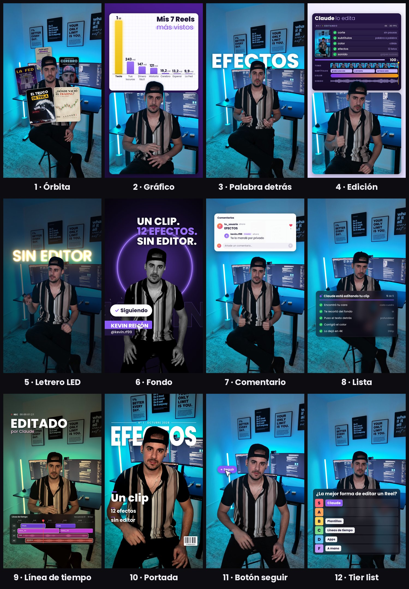

# Efectos para tus vídeos

**19 efectos de edición para tus Reels, con un comando.** Le pasas a Claude tu vídeo hablando a cámara, le dices qué
efecto quieres y en qué segundo, y en un minuto te deja el vídeo editado al lado del original. Tu voz se queda igual.



- **Gratis** y de código abierto (MIT).
- **Corre en tu computadora**: tu vídeo no se sube a ningún sitio.
- Mac, Windows y Linux. En Mac usa el recorte del propio sistema, más fino en orejas, pelo y dedos.

Hecho por **Kevin Remón** · Instagram [@kevin.rf99](https://www.instagram.com/kevin.rf99/)

---

## Instalarlo (una vez)

1. Abre **Claude** en tu computadora, en la pestaña **Code** (en la pestaña Chat no funciona). Te vale cualquier carpeta.
2. Pégale esto:
   ```
   Instala los efectos de github.com/remonkevin99-collab/efectos en mi carpeta de skills, con todo lo que necesiten para funcionar
   ```
3. **Claude te irá pidiendo permiso** para descargar e instalar lo que hace falta (Python, los modelos…): dale a Permitir. Solo
   pasa la primera vez. En Mac, si te pide instalar las herramientas de Apple, acepta.
4. Cuando te diga que terminó, cierra Claude y vuelve a abrirlo.

## Usarlo

1. En Claude, en la pestaña **Code**, arrastra tu vídeo a la caja donde escribes.
2. Escribe el efecto y cuándo:
   ```
   /efectos órbita del segundo 2 al 5
   ```
   ```
   /efectos palabra-detrás con la palabra NEGOCIO del 1 al 3, y la lista del 5 al 8
   ```
3. Claude mira unos cuadros antes, para que nada te tape la cara, y te deja `tuvideo_efectos.mp4`.

**Casi nunca sale perfecto a la primera:** míralo y pídele retoques con palabras normales («más pequeño», «más lento», «la palabra más arriba») hasta que te guste.

¿Subtítulos? Si quieres, pídele a Claude que se los ponga a tu vídeo. La música y los efectos de sonido no van incluidos: ponlos al subir o en tu editor.

## Los 19 efectos

| | Efecto | Qué hace |
|---|---|---|
| 1 | `cristal` | Ocho tarjetas de cristal a tu alrededor, algunas por detrás de ti: el contador, tu nombre, un calendario, lo que se está editando y «sin editor» |
| 2 | `fondo` | Te cambia el fondo entero: en blanco y negro, con tu nombre, tu titular y un botón de Seguir que alguien pulsa |
| 3 | `órbita` | Tus portadas giran a tu alrededor, por detrás de ti y por delante; se abren y se aceleran con tu gesto |
| 4 | `gráfico` | La pantalla se divide: tus números en barras arriba y tú abajo, con la cabeza saliendo del corte |
| 5 | `letrero-led` | Se apaga la luz y se enciende tu letrero detrás de ti, letra a letra |
| 6 | `tier-list` | Una tabla de la S a la F, y lo tuyo vuela hasta la S |
| 7 | `línea-tiempo` | Color de cine y una línea de edición encima, con su título |
| 8 | `edición` | La pantalla se divide: el panel de edición arriba (los pasos, la línea de tiempo y el 100 %) y tú abajo |
| 9 | `palabra-detrás` | Una palabra gigante detrás de tu cabeza |
| 10 | `comentario` | Un comentario que se escribe solo, le dan corazón y llega tu respuesta |
| 11 | `lista` | Una lista que se va marcando sola |
| 12 | `portada` | Te conviertes en la portada de una revista |
| 13 | `botón-seguir` | Aparece un botón de Seguir y alguien lo pulsa |
| 14 | `carrusel` | Tus Reels salen de tu móvil y giran encima de él; el de más vistas pasa por delante con su número |
| 15 | `sobre-el-hombro` | La cámara se acerca y aparece una tarjeta de cristal con tu número subiendo y su gráfica |
| 16 | `muro` | Detrás de ti, una página llena de texto con una palabra resaltada |
| 17 | `mensajes` | Te llegan mensajes uno detrás de otro, como en el iPhone |
| 18 | `interruptores` | Encima de tu cabeza, unos interruptores que se encienden uno a uno |
| 19 | `cuadrícula` | Te alejas y caes en el centro de tu perfil, rodeado de tus Reels con sus vistas |

## Antes de grabarte

Los efectos recortan tu silueta para poner cosas detrás de ti. Cuanto más fácil se lo pongas, más limpio queda.

1. **En vertical y en 4K**, con el móvil fijo. En iPhone, el HDR apagado: Ajustes › Cámara › Formatos › Vídeo HDR.
2. **De la cintura para arriba**, centrado y con un palmo de aire sobre la cabeza: ahí van los títulos y las tarjetas.
3. **Detrás de ti, poco y lejos:** al menos un metro de espacio y nada pegado a tu cabeza ni a tus hombros.
4. **Sin silla de respaldo alto:** mejor de pie o en un taburete.
5. **La luz, de frente:** una luz fuerte justo detrás de ti te deja un borde brillante que se nota al recortarte.
6. **Ropa que se separe del fondo.**
7. **Las manos, lejos de la cara**, y 3 segundos quieto al empezar y al terminar.
8. **Gestos que los efectos aprovechan:** señala arriba para el gráfico, a un lado para el botón de seguir, o haz como que
   deslizas para que la órbita se acelere.

## Para Claude: cómo se instala

Haz esto en orden y dile a la persona cómo va.

1. **Copia el repositorio en la carpeta de skills de la persona**, con el nombre `efectos`:
   - Mac y Linux: `git clone --depth 1 https://github.com/remonkevin99-collab/efectos.git ~/.claude/skills/efectos`
   - Windows (PowerShell): `git clone --depth 1 https://github.com/remonkevin99-collab/efectos.git "$HOME\.claude\skills\efectos"`
   - Sin git: baja https://github.com/remonkevin99-collab/efectos/archive/refs/heads/main.zip, descomprímelo y deja la
     carpeta como `~/.claude/skills/efectos` (que dentro esté `SKILL.md`, no otra carpeta).
   - Si ya existe, actualízala con `git pull` en vez de clonarla.
2. **Corre la instalación** dentro de esa carpeta. Crea su propio Python (3.10 a 3.12), instala lo necesario y baja dos
   modelos de Google. Tarda unos minutos la primera vez.
   - Mac y Linux: `bash instalar.sh`
   - Windows: `powershell -ExecutionPolicy Bypass -File instalar.ps1`
3. **Comprueba** que dice «Todo bien.»:
   - Mac y Linux: `.venv/bin/python efectos.py --comprobar`
   - Windows: `.venv\Scripts\python.exe efectos.py --comprobar`
4. **Dile a la persona** que cierre Claude y lo vuelva a abrir: después ya puede escribir `/efectos`.

Si la computadora no tiene Python 3.10–3.12, la instalación baja [uv](https://docs.astral.sh/uv/) y con él su propio Python,
sin tocar el del sistema. En Mac, si dice «para tenerlo, corre 'xcode-select --install'», córrelo: se abre una ventana de
Apple y la persona le da a Instalar; al acabar, vuelve a correr la instalación. Cómo se usa después está en `SKILL.md`.

## Sin Claude, desde la terminal

```
.venv/bin/python efectos.py --lista                                  # los efectos y sus opciones
.venv/bin/python efectos.py orbita video.mp4 --desde 2 --hasta 6     # uno suelto
.venv/bin/python efectos.py palabra-detras video.mp4 --op texto=HOLA # con opciones
.venv/bin/python efectos.py video.mp4 --plan plan.json               # varios a la vez
.venv/bin/python efectos.py video.mp4 --plan plan.json --fotos 1,3   # solo unas fotos, para revisar
```

Todas las opciones: `.venv/bin/python efectos.py --ayuda`.

## Licencias

- **El código**: MIT, de Kevin Remón (`LICENSE`).
- **La letra Poppins**: SIL Open Font License (`fuentes/LICENCIA-Poppins.txt`).
- **Los dos modelos de Google** que baja la instalación (la persona y la cara, de MediaPipe): Apache 2.0 (`modelos/AVISO.md`).
